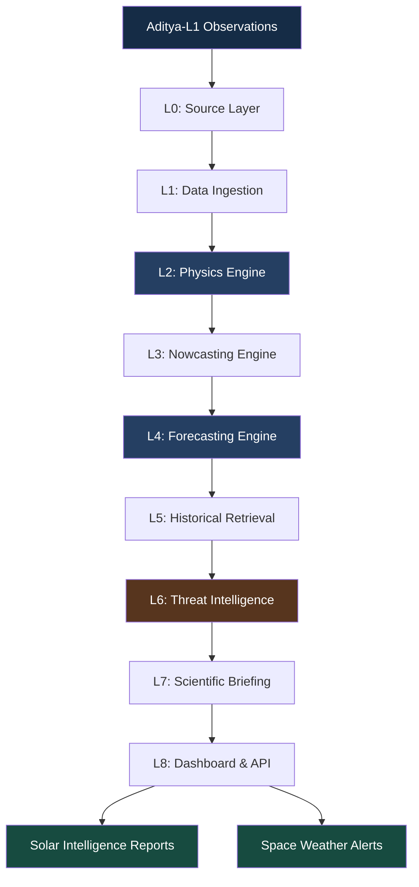

<!-- ========================================================= -->
<!--                         ARUNA                             -->
<!-- ========================================================= -->

<p align="center">
  
</p>

<h3 align="center">
  ADITYA-L1 REAL-TIME UNIFIED NOWCASTING & ALERT SYSTEM
</h3>

<p align="center">
  <strong>FORESEE. PREPARE. PROTECT.</strong>
</p>

<p align="center">
  An open-source initiative exploring physics-grounded solar
  intelligence using observations from India's Aditya-L1 mission.
</p>

<p align="center">
  <a href="LICENSE">
    
  </a>
  
  
  
  
</p>

<p align="center">
  <a href="#overview">Overview</a> •
  <a href="#scientific-foundation">Science</a> •
  <a href="#architecture">Architecture</a> •
  <a href="#capabilities">Capabilities</a> •
  <a href="#technology-stack">Technology</a> •
  <a href="#roadmap">Roadmap</a> •
  <a href="#contributing">Contributing</a>
</p>

---

# ☀️ Overview

**ARUNA** (Aditya-L1 Real-time Unified Nowcasting & Alert System) is an open-source space-weather intelligence project designed to explore the transformation of solar observations into interpretable scientific insights, predictive intelligence and operationally relevant alerts.

Built around India's Aditya-L1 solar observation mission, ARUNA investigates how multi-instrument observations, physics-informed diagnostics, machine learning and probabilistic forecasting can be integrated into a unified solar intelligence pipeline.

The project focuses on bridging the gap between raw solar observations and actionable space-weather intelligence.

Rather than treating solar observations as isolated datasets, ARUNA explores a connected scientific workflow involving:

- Multi-instrument solar data ingestion.
- Physics-grounded feature extraction.
- Solar flare detection and classification.
- Predictive time-series modelling.
- Historical event retrieval.
- Probabilistic forecasting and uncertainty assessment.
- Space-weather impact intelligence.
- Automated scientific reporting.

> **The vision:** Make complex solar observations more accessible, interpretable and useful through reproducible scientific computing.

---

# 🌍 The Problem

Solar activity is one of the major natural drivers of space-weather disturbances.

Solar flares and associated phenomena can influence:

| Infrastructure | Potential impact |
|---|---|
| Satellites | Radiation exposure and operational disturbances |
| Navigation | GNSS and navigation signal degradation |
| Communication | HF radio communication disruptions |
| Aviation | Radiation exposure and communication risks |
| Spaceflight | Radiation-related astronaut safety considerations |
| Power infrastructure | Geomagnetically induced currents during relevant solar events |

Although scientific missions continuously collect valuable solar observations, transforming those observations into timely and interpretable intelligence remains a complex challenge.

ARUNA explores an integrated approach to this challenge through scientific data engineering, physics-informed modelling and predictive analytics.

---

# 🛰️ Scientific Foundation

ARUNA is designed around two complementary solar observation instruments aboard **Aditya-L1**.

## 1. SoLEXS

**Solar Low Energy X-ray Spectrometer**

SoLEXS observes solar soft X-ray emissions and provides information useful for understanding thermal plasma behaviour during solar flares.

Research applications include:

- Soft X-ray flux analysis.
- Plasma temperature estimation.
- Emission measure evolution.
- Thermal response analysis.
- Flare progression monitoring.

## 2. HEL1OS

**High Energy L1 Orbiting X-ray Spectrometer**

HEL1OS observes higher-energy solar X-ray emissions and provides complementary information about energetic flare processes.

Research applications include:

- Hard X-ray observations.
- Energetic particle-related diagnostics.
- Spectral evolution.
- Flare phase analysis.
- Thermal–nonthermal interpretation.

## Dual-instrument intelligence

The central scientific direction of ARUNA is to investigate how complementary SoLEXS and HEL1OS observations can be aligned and analysed together.

This enables research into:

- Multi-energy observation fusion.
- Thermal and nonthermal behaviour.
- Spectral evolution.
- Flare progression.
- Physics-informed predictive features.

---

# ⚙️ Architecture

ARUNA follows a modular, multi-layer scientific computing architecture.

The proposed processing pipeline is organised into nine layers.



### Layer responsibilities

| Layer | Component | Responsibility |
|---|---|---|
| L0 | Source Layer | Scientific observation source management |
| L1 | Data Ingestion | FITS ingestion, validation and time alignment |
| L2 | Physics Engine | Physical diagnostics and feature extraction |
| L3 | Nowcasting Engine | Flare detection and classification |
| L4 | Forecasting Engine | Predictive time-series modelling |
| L5 | Historical Retrieval | Similarity-based historical event analysis |
| L6 | Threat Intelligence | Potential infrastructure impact assessment |
| L7 | Scientific Briefing | Interpretable scientific summaries |
| L8 | Dashboard & API | Visualisation and system integration |

The architecture also describes **ARUNA-XL**, an extension direction for broader solar, heliophysical and Earth-impact intelligence.

*Architecture documentation describes the intended system design. Individual components are at different implementation and validation stages.*

---

# 🧠 Capabilities & Research Directions

## Solar Physics Intelligence

Research-oriented physical diagnostics include:

- Plasma temperature estimation.
- Emission measure evolution.
- Spectral hardness analysis.
- Thermal–nonthermal phase-space analysis.
- Dynamic Neupert Integral (DNI).
- Multi-instrument temporal correlation.

## Solar Flare Intelligence

- Flare onset identification.
- Flare event classification.
- Solar activity monitoring.
- Historical flare comparison.
- Event evolution analysis.
- Precursor identification research.

## Predictive Intelligence

- Time-series forecasting.
- Physics-informed feature engineering.
- Multi-stream model integration.
- Probabilistic prediction.
- Uncertainty estimation.
- Forecast calibration.

## Historical Event Intelligence

- Historical event indexing.
- Similarity-based retrieval.
- Dynamic Time Warping.
- Feature-space comparison.
- Event reconstruction and analysis.

## Space-Weather Impact Assessment

Potential research applications include:

- Satellite operational risk indicators.
- NavIC-related risk assessment.
- HF communication disruption analysis.
- Radiation-risk considerations for human spaceflight.
- Solar event impact reporting.

These capabilities are research objectives and should not be interpreted as validated operational forecasting services unless explicitly demonstrated.

---

# 🔬 Technology Stack

ARUNA combines scientific computing, machine learning, data engineering and application development.

| Domain | Technologies |
|---|---|
| Scientific Computing | Python, NumPy, SciPy |
| Astronomy | Astropy, SunPy |
| Data Processing | FITS, scientific data pipelines |
| Machine Learning | PyTorch |
| Forecasting | Time-series modelling |
| Calibration | MAPIE |
| Similarity Retrieval | FAISS, Dynamic Time Warping |
| Backend | Python API services |
| Visualisation | Plotly, Streamlit |
| Deployment | Docker, Docker Compose |

Refer to the actual module dependency manifests for currently implemented integrations.

---

# 📁 Repository Structure

```text
ARUNA-ISRO/
│
├── .agents/
│
├── api/
│   └── Backend and API components
│
├── config/
│   └── Configuration files
│
├── data/
│   └── Data resources and datasets
│
├── docs/
│   ├── arunabanner.svg
│   └── Project documentation
│
├── models/
│   └── Model components
│
├── notebooks/
│   └── Research and experimentation
│
├── python/
│   └── Scientific computing implementation
│
├── web/
│   └── Web interface
│
├── ARUNA_Pipeline_PRD.md
├── TRAIN_FORECAST.md
├── eval_model.py
├── fit_mapie.py
│
├── docker-compose.yml
├── docker-compose.dev.yml
├── .env.example
│
└── README.md
```

---

# 🚀 Getting Started

ARUNA is under active development. The following steps provide the initial repository setup.

## Prerequisites

- Python 3.10+
- Git
- Docker and Docker Compose (for supported container workflows)

## Clone the repository

```bash
git clone https://github.com/Aditya-Kumrawat/ARUNA-ISRO.git

cd ARUNA-ISRO
```

## Configure environment variables

```bash
cp .env.example .env
```

Configure the required environment variables for your environment.

## Install dependencies

Install the dependencies specified by the relevant module's dependency manifest.

## Run the project

Refer to the individual module documentation and deployment configuration for the appropriate entry points.

> A fully verified end-to-end installation workflow is still being standardised. Avoid assuming all services are currently deployable through a single command.

---

# 📚 Research & Documentation

The repository includes engineering documentation describing the system's intended architecture and research workflow.

| Document | Description |
|---|---|
| `ARUNA_Pipeline_PRD.md` | End-to-end architecture and engineering specification |
| `TRAIN_FORECAST.md` | Forecasting workflow documentation |
| `eval_model.py` | Model evaluation utility |
| `fit_mapie.py` | Forecast calibration utility |

For implementation details, consult the individual modules and their documentation.

---

# 🧪 Scientific Validation

Scientific reliability is essential for any system dealing with space-weather intelligence.

ARUNA aims to establish reproducible evaluation practices involving:

- Data integrity and preprocessing validation.
- Instrument-level temporal alignment.
- Physical consistency checks.
- Historical event benchmarking.
- Forecast accuracy evaluation.
- Probabilistic calibration.
- Uncertainty analysis.
- Reproducible experimentation.

Predictions and risk assessments should be independently validated against authoritative scientific observations before any operational use.

**ARUNA is an independent research and engineering project. It is not an official ISRO service and does not claim ISRO endorsement or operational deployment.**

---

# 🗺️ Roadmap

The project is being developed incrementally.

### Phase 1 — Scientific Foundation

- [ ] Standardise scientific data ingestion.
- [ ] Strengthen SoLEXS and HEL1OS preprocessing.
- [ ] Establish instrument-level validation.
- [ ] Implement reproducible physics diagnostics.

### Phase 2 — Solar Intelligence

- [ ] Benchmark flare detection.
- [ ] Develop physics-informed feature pipelines.
- [ ] Evaluate predictive modelling.
- [ ] Improve forecast calibration.

### Phase 3 — Historical Intelligence

- [ ] Expand historical event retrieval.
- [ ] Introduce similarity-based analysis.
- [ ] Develop event reconstruction workflows.

### Phase 4 — Space-Weather Intelligence

- [ ] Expand threat assessment.
- [ ] Validate infrastructure impact indicators.
- [ ] Improve scientific briefing generation.
- [ ] Integrate dashboard and alert services.

### Phase 5 — Open Scientific Ecosystem

- [ ] Publish reproducible benchmarks.
- [ ] Improve documentation.
- [ ] Encourage external research contributions.
- [ ] Expand scientific integrations.

---

# 🤝 Contributing

ARUNA welcomes contributions from developers, researchers, astronomers, data scientists and space-technology enthusiasts.

Potential contribution areas:

- Solar physics and scientific diagnostics.
- Scientific data processing.
- Machine learning and forecasting.
- Statistical validation.
- Historical event retrieval.
- API and backend development.
- Scientific visualisation.
- Documentation and testing.

### Contribution workflow

1. Fork the repository.
2. Create a feature branch.
3. Implement your changes.
4. Test and document the changes.
5. Submit a pull request with a clear explanation.

For substantial changes, consider opening an issue first to discuss the proposed approach.

---

# 👨‍💻 Maintainer

**Aditya Kumrawat**

Creator and primary maintainer of ARUNA.

- GitHub: [@Aditya-Kumrawat](https://github.com/Aditya-Kumrawat)
- Repository: [ARUNA-ISRO](https://github.com/Aditya-Kumrawat/ARUNA-ISRO)

---

# 📜 License

This project is licensed under the **MIT License**.

You are free to use, modify, distribute and build upon the software, subject to the conditions of the license.

See the [LICENSE](LICENSE) file for complete details.

---

<p align="center">
  <strong>ARUNA</strong>
</p>

<p align="center">
  FORESEE. PREPARE. PROTECT.
</p>

<p align="center">
  Exploring the future of physics-grounded solar intelligence.
</p>

<p align="center">
  <sub>Built with curiosity, scientific thinking and open-source engineering.</sub>
</p>
